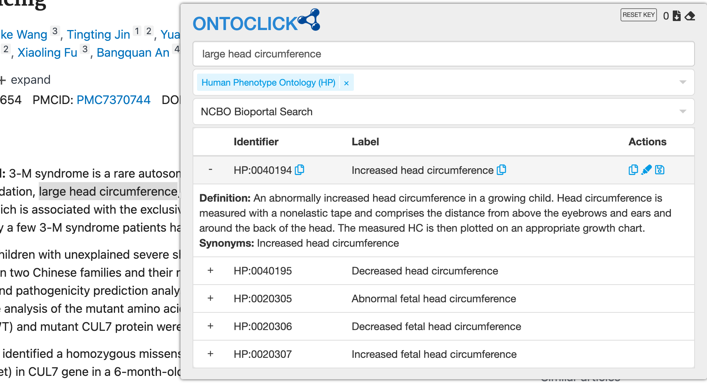

# Ontoclick


#### Turn a free text description into a proper ontology term with just one click.

### Overview

Ontoclick is a web browser extension for Chrome and Firefox browsers that lets the user highlight a piece of text and then tries to find a matching Ontology term for it.

Ontoclick currently supports matching terms to the [Human Phenotype Ontology](https://hpo.jax.org/app/), [Gene Ontology](http://geneontology.org), [Mondo Disease Ontology](https://mondo.monarchinitiative.org), [Orphanet Rare Disease Ontology](http://www.orphadata.org/cgi-bin/index.php#ontologies) and [Human Disease Ontology](https://disease-ontology.org).

Ontoclick can use the [NCBO BioPortal Search API](http://data.bioontology.org/documentation#nav_search), [NCBO BioPortal Annotator API](http://data.bioontology.org/documentation#nav_annotator), the [EBI Ontology Lookup Service Search API](https://www.ebi.ac.uk/ols4/help) or the [HPO Search API](https://ontology.jax.org/api/hp/docs) to find matching ontology terms. The HPO Search API only supports searching the Human Phenotype Ontology.

> [!NOTE]
> To use the NCBO BioPortal API, create a free account at https://bioportal.bioontology.org and copy the API key listed in your account. You will be asked for it the first time you select 'NCBO Bioportal Search' or 'NCBO Bioportal Annotator'. Use the 'RESET KEY' button to change the key later. EBI OLS and HPO Search do not require an API key.

The search results can be copied to the clipboard or saved to a list that can be exported in .CSV format.

### Screenshot



### Publication

*Ontoclick: a web browser extension to facilitate biomedical knowledge curation*\
[BioRxiv](https://www.biorxiv.org/content/10.1101/2021.03.04.433993v2) or [Bioinformatics (Oxford University Press)](https://doi.org/10.1093/bioinformatics/btab520)

### Acknowledgements

The first version of Ontoclick was created at [Health Hack Sydney](https://speakerdeck.com/azankl/ontoclick-pitch-healthhack-2017) in November 2017. Many thanks to Team Ontoclick, in particular Graham Towse from [LivingryLabs](https://www.livingrylabs.net/). Many thanks to Anthony Xu, Yifei (Frank) Luo, Aravind Venkateswaran, Lianguizi (Alisa) Zhou, and Claude for further improving this prototype.

### Install for Chrome

Ontoclick is available on the Chrome Store [here](https://chrome.google.com/webstore/detail/ontoclick/nepbilmonlfaigoeldkbimkeihligbgf).

### Install for Firefox

Ontoclick is available as a Firefox Add-On [here](https://addons.mozilla.org/en-US/firefox/addon/ontoclick/)

### How to Use the Extension

1. Visit a web page in your browser
2. Highlight the text you want to search for, right-click to show the browser context menu and select Ontoclick from the context menu.
3. The Ontoclick popup opens and displays matching ontology terms from the Human Phenotype Ontology, using the EBI Ontology Lookup Service.
4. Click on the '+' icon in front of a term to see more information about the term (if available).
5. Hover over a term to see additional icons:
   - click the 'copy' icon next to the Ontology ID to copy the Ontology ID
   - click the 'copy' icon next to the Label to copy the Ontology Label
   - click the 'copy' icon in the 'Actions' column to copy the Ontology ID _and_ the Label
   - click the 'highlighter' icon in the 'Actions' column to copy the highlighted text _and_ the Ontology ID _and_ the Label.
   - click the 'disk' icon in the 'Actions' column to save the highlighted text, Ontology ID and Label to Ontoclick's history list. The number in the right upper corner of the Ontoclick window shows the number of items saved to the history list. Click the 'download' icon to download the history list as a .CSV file. Click the 'eraser' icon to erase the history list.
6. If no suitable terms are retrieved, click on the triangle next to 'Ontology Lookup Search EBI' to re-run the search with a different concept recogniser. The result window will update immediately with the new results. The different concept recognisers all have their strengths and weaknesses, try different ones to see what gives the best results.
7. Click on the triangle next to 'Human Phenotype Ontology' to select another (or additional) ontologies. This only works when 'NCBO Bioportal Search', 'NCBO Bioportal Annotator' or 'Ontology Lookup Search EBI' are selected.
8. The Ontoclick Popup can also be launched without selecting any text:
   - right-click anywhere in the browser window and select Ontoclick from the context menu that appears
   - click the Ontoclick icon in the browser toolbar
   - in both cases, you can now type your search term into the Ontoclick Search bar
   - Please note: the history list function is not available when launching the Ontoclick popup from the toolbar icon

### Install From Source

**Build Prerequisites**

* [Node.js](https://nodejs.org) 22.12 or later (the version used for releases is in `.nvmrc`)
* [Yarn](https://classic.yarnpkg.com/en/docs/install) 1.x

``` bash
# install dependencies
yarn install

# build for production with minification
yarn build
```

To install, go to Chrome:
1. Visit chrome://extensions
2. Enable Developer mode
3. Click 'Load unpacked'
4. Select the ontoclick/dist/ folder

The build from source currently targets Chrome only: the Manifest V3 background service worker is not yet supported by Firefox. The Firefox Add-On above is still the older Manifest V2 version.

### Toolchain

* [Manifest V3](https://developer.chrome.com/docs/extensions/develop/migrate/what-is-mv3) Chrome extension
* [Vue 2.7](https://v2.vuejs.org) and [Vuex 3](https://v3.vuex.vuejs.org)
* [webpack 5](https://webpack.js.org) build (`webpack.config.js`), with build-time settings such as the API endpoints in `build/env.js`
* [Vitest](https://vitest.dev) unit tests in `test/`
* [ESLint 9](https://eslint.org) with [eslint-plugin-vue](https://eslint.vuejs.org) (`eslint.config.mjs`)
* [GitHub Actions](.github/workflows/main.yml) lints, tests and packages the extension on every push and pull request to `master`; the packaged .zip is attached to each run


### Development Setup

``` bash
# install dependencies
yarn install


# rebuild dist/ on every change; click the reload icon at chrome://extensions to pick up changes
yarn dev

# build for production with minification
yarn build

# build and package dist/ as ontoclick-<version>.zip for the Chrome Web Store
yarn zip

# run unit tests
yarn test

# lint
yarn lint
```
